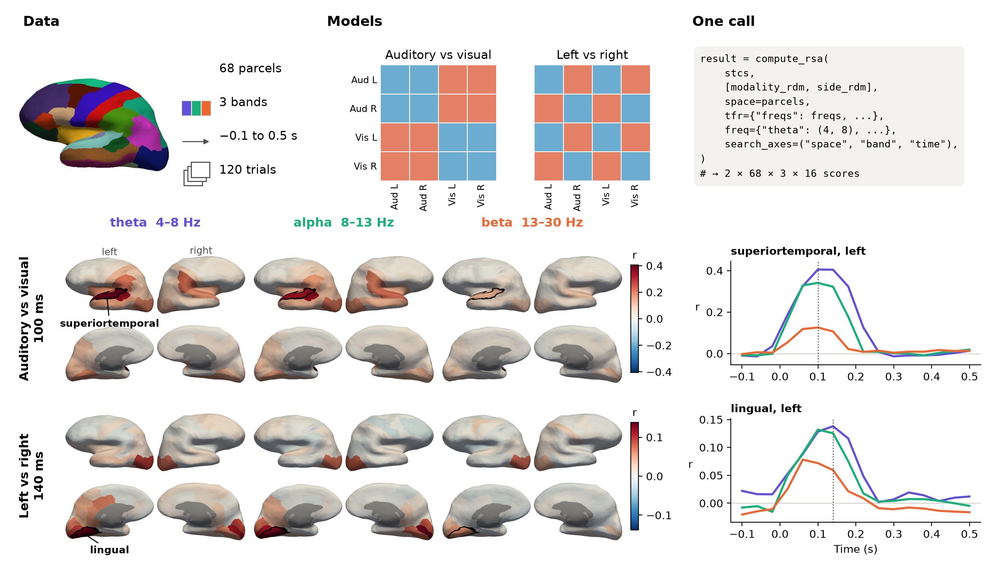

# rsa-nd

**Representational similarity analysis (RSA) over any EEG/MEG features and
dimensions.**

`rsa-nd` extends [MNE-Python](https://mne.tools/) and
[mne-rsa](https://mne.tools/mne-rsa/). Give it an MNE object or a named N-D
array and say which axes to search over. It builds the feature tensor, runs the
searchlight through `mne-rsa`, and returns a result that keeps its axis names
and coordinates.



*One `compute_rsa()` call searches brain parcels, frequency bands and time, for two
models at once. `mne-rsa` alone searches parcels and time. Data: one participant
from the MNE sample dataset, shown without statistics. See
[the code](examples/plot_00_overview.py).*

```python
from rsa_nd import compute_rsa

result = compute_rsa(
    tfr,  # an mne EpochsTFR
    model_rdm,
    freq={"alpha": (8, 13), "beta": (13, 30)},
    search_axes=("space", "time"),
    radii={"space": 0.04, "time": 0.02},
)
print(result.axes, result.rsa.shape)
```

As in `mne-rsa`, each MNE event code marks one item, so epochs that share a code
are treated as repeats of the same item. If that doesn't match your model RDM,
pass `labels=` and `labels_rdm_model=` to say which row belongs to which item.

## The gap it fills

MNE-Python computes your features, and `mne-rsa` does the RSA. Its ready-made
functions search space and time on `Epochs`, `Evoked` and source estimates.

Any other question has to go through `mne_rsa.rsa_array`. For each new analysis,
you flatten the data to two dimensions, write the searchlight patches yourself,
then put the scores back on labelled axes. That makes a question such as "which
frequencies carry this model?" a small programming project, and index mistakes
in that code fail silently.

`rsa-nd` closes this gap with one rule: **name your axes, then say which ones to
search.** Every other axis becomes the features of each searchlight position.


| Question | With `mne-rsa` alone | With `rsa-nd` |
| --- | --- | --- |
| Which sensors and times? | `rsa_epochs(epochs, ...)` | `search_axes=("space", "time")` |
| Which regions and times? | `rsa_stcs_rois(stcs, ...)` | `space=labels` |
| Which frequencies and times? | Your own code around `rsa_array` | `search_axes=("freq", "time")` |
| Which bands, in which regions? | Your own code around `rsa_array` | `freq={"alpha": (8, 13)}, space=labels` |
| Does phase carry it, not just power? | Your own code around `rsa_array` | `tfr_feature="phase"` |
| Any other dimension? | Your own code around `rsa_array` | Name the axis |

`rsa-nd` adds no new RSA maths. All scores still come from `mne-rsa`, and the tests
confirm that results match `rsa_epochs`, `rsa_evokeds` and `rsa_stcs`. It adds:

- **More input types:** `Epochs`, `EpochsTFR`, `EpochsSpectrum`, and lists of
  `Evoked`, `AverageTFR`, `Spectrum` or source estimates, plus any named N-D
  array.
- **One vocabulary for every dimension:** `time`, `freq` and `space` are all
  searchable axes. Each can be searched with a radius, one element at a time, or
  by named group, or pooled into the features. Named groups can also be averaged
  into bands, windows and regions.
- **Time-frequency features:** power, amplitude, phase, real/imaginary and
  amplitude/phase projections of complex TFRs.
- **Dynamic RSA:** `rsa_dynamic` and `rsa_dynamic_windows` for time-lagged and
  windowed model comparisons.
- **Self-describing results:** `RsaResult` keeps axes and coordinates, converts
  to an MNE container with `.to_mne()`, and saves to HDF5 with `.save()`.

## How it fits a real analysis

`rsa-nd` is one step in a normal MNE pipeline, not a replacement for it:

| Step | Tool |
| --- | --- |
| Clean, epoch, compute source estimates | MNE-Python |
| Build the model RDMs | `mne_rsa.compute_rdm`, or your own |
| Build features, search, and label the results | `rsa-nd` |
| Compute the data RDMs and compare them with the model | `mne-rsa`, called by `rsa-nd` |
| Plot and run group statistics | MNE-Python, through `.to_mne()` or `.rsa` |

A typical study runs RSA per participant, then tests the scores across the group:

```python
import mne
import mne_rsa
import numpy as np
from mne.stats import permutation_cluster_1samp_test

from rsa_nd import compute_rsa

# Model: one row per stimulus, in the order of the sorted event codes
model_rdm = mne_rsa.compute_rdm(stimulus_features, metric="euclidean")

freqs = np.arange(4.0, 31.0)
scores = []
for subject in subjects:
    # Features: your usual MNE pipeline
    epochs = mne.read_epochs(f"{subject}-epo.fif")
    tfr = epochs.compute_tfr(
        "morlet", freqs=freqs, n_cycles=freqs / 2, return_itc=False, average=False
    )

    # RSA: the question is set by the axes you search
    result = compute_rsa(
        tfr,
        model_rdm,
        freq={"theta": (4, 8), "alpha": (8, 13), "beta": (13, 30)},
        log=True,
        search_axes=("band", "time"),
        radii={"time": 0.02},
    )
    result.save(f"{subject}-rsa.h5")
    scores.append(result.rsa)

# Group statistics: scores have shape (subjects, bands, times)
t_obs, clusters, p_values, _ = permutation_cluster_1samp_test(np.stack(scores), tail=1)
```

To ask a different question, change only the `compute_rsa()` arguments. For
example, `search_axes=("space", "time")` gives a sensor map for each band.

[`examples/plot_group_stats.py`](examples/plot_group_stats.py) runs a complete
version on real data: 10 participants of the LIMO EEG dataset, a channel
searchlight over time for two models, and a cluster test across participants that
joins neighbouring channels and times. It lists `"time"` before `"space"` in
`search_axes`, so that the scores come out as times × channels, the layout that
MNE's cluster tests expect.

## Install

```bash
pip install git+https://github.com/weiyongxu/rsa-nd.git
```

`rsa-nd` needs Python 3.10+, MNE-Python 1.8+ and mne-rsa 1.x.

## Quick start

### Any named array

```python
import numpy as np
from rsa_nd import rsa_nd

rng = np.random.default_rng(0)
data = rng.standard_normal((8, 5, 20))  # items x freq x time
model_rdm = np.abs(np.subtract.outer(np.arange(8.0), np.arange(8.0)))

result = rsa_nd(
    data,
    model_rdm,
    axes=("item", "freq", "time"),
    coords={"freq": [4, 8, 13, 20, 30], "time": np.linspace(0, 0.95, 20)},
    search_axes=("time",),
    radii={"time": 0.1},
)
print(result.axes, result.rsa.shape)  # ('time',) (20,)
```

### Prepare once, test many models

`compute_rsa()` is the one-call shortcut. To score several models against the
same features, prepare the data once:

```python
from rsa_nd import prepare_rsa_data, rsa_nd

prepared = prepare_rsa_data(tfr, freq={"alpha": (8, 13)}, log=True)
semantic = rsa_nd(
    prepared,
    semantic_rdm,
    search_axes=("space", "time"),
    radii={"space": 0.04, "time": 0.02},
)
visual = rsa_nd(
    prepared,
    visual_rdm,
    search_axes=("space", "time"),
    radii={"space": 0.04, "time": 0.02},
)
```

### Source ROI time-frequency RSA

```python
result = compute_rsa(
    stcs,
    model_rdm,
    space=labels,
    tfr={"freqs": np.arange(8, 31), "n_cycles": 2.0},
    search_axes=("space", "time"),
    radii={"time": 0.02},
)
```

### Save and reload

```python
from rsa_nd import RsaResult

result.save("result.h5")
result = RsaResult.load("result.h5")
evoked_like = result.to_mne()
```

## Examples

Short examples are in `examples/`. The sensor and source examples download the
MNE sample dataset on first use, and the group example downloads 10 participants
of the LIMO dataset (about 1.2 GB, and it needs `pandas`).

| Example | Shows |
| --- | --- |
| `plot_00_overview.py` | Brain parcels by frequency band by time, for two models: the figure at the top of this page |
| `plot_any_dimensions.py` | Searching any axes of simulated data, with named groups and several models |
| `plot_sensor_tfr.py` | Time-frequency RSA on MEG sensors, using power and phase |
| `plot_source_rois.py` | Time-frequency RSA in anatomical regions |
| `plot_dynamic.py` | Recovering the lag between a changing model and neural data |
| `plot_group_stats.py` | RSA for each of 10 EEG participants, then a cluster permutation test across them |

## Testing

`tests/test_combinations.py` checks every input type and dimension setup against
an independent brute-force calculation, and `tests/test_rsa.py` confirms that
results match `mne_rsa.rsa_epochs`, `rsa_evokeds` and `rsa_stcs`.

## Development

```bash
uv sync
uv run pytest tests/ -m "not slowtest"
RSA_ND_ALL_CASES=1 uv run pytest tests/test_combinations.py  # all ~35,000 cases
uv run ruff check .
uv run sphinx-build -b html docs/source docs/build/html
```

## Citing

See [CITATION.cff](CITATION.cff). Please also cite
[MNE-Python](https://mne.tools/stable/documentation/cite.html) and
[mne-rsa](https://mne.tools/mne-rsa/).

## License

MIT License. See [LICENSE.txt](LICENSE.txt).

## Acknowledgments

`rsa-nd` builds on [MNE-Python](https://mne.tools/) and
[mne-rsa](https://mne.tools/mne-rsa/) by Marijn van Vliet and contributors.
