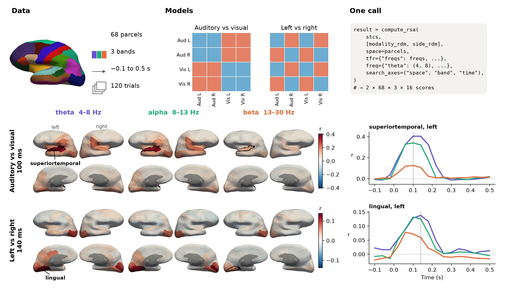
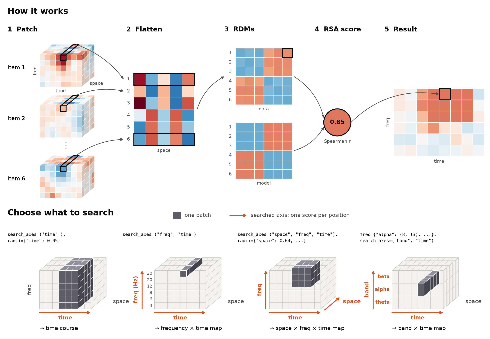

rsa-nd
======

Representational similarity analysis (RSA) over any EEG/MEG features and
dimensions, built on `MNE-Python <https://mne.tools/>`_ and
`mne-rsa <https://mne.tools/mne-rsa/>`_.

Give ``rsa-nd`` an MNE object or a named N-D array and say which axes to search
over. It builds the feature tensor, runs the searchlight through ``mne-rsa``,
and returns a result that keeps its axis names and coordinates.

         time, for two models: brain maps of scores per band, and time courses of
         the peak parcel.

   One :func:`~rsa_nd.compute_rsa` call searches brain parcels, frequency bands
   and time, for two models at once. ``mne-rsa`` alone searches parcels and time.
   Data: one participant from the MNE sample dataset, shown without statistics.
   See :doc:`the code <auto_examples/plot_01_overview>`.

The gap it fills
----------------

MNE-Python computes your features, and ``mne-rsa`` does the RSA. Its ready-made
functions search space and time on ``Epochs``, ``Evoked`` and source estimates.

Any other question has to go through :func:`mne_rsa.rsa_array`. For each new
analysis, you flatten the data to two dimensions, write the searchlight patches
yourself, then put the scores back on labelled axes. That makes a question such
as "which frequencies carry this model?" a small programming project, and index
mistakes in that code fail silently.

``rsa-nd`` closes this gap with one rule: **name your axes, then say which ones to
search.** Every other axis becomes the features of each searchlight position. It
adds no new RSA maths: all scores still come from ``mne-rsa``.

         frequency and space; the same patch from each cube is flattened into one
         row, the rows give a data RDM that is correlated with a model RDM, and the
         score fills one cell of a frequency by time result. Bottom: four cubes
         show which part of the cube one patch covers when searching time,
         frequency and time, all three axes, or frequency bands and time.

.. toctree::
   :maxdepth: 2

   installation
   quickstart
   auto_examples/index
   api
